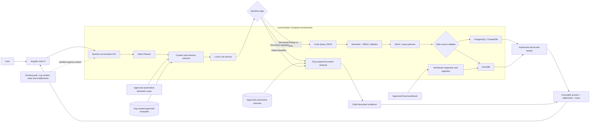

# Automotive Conversational AI PoC — Implementation Plan

**Status:** Draft for review  
**Reference:** Wren AI  
**Foundation:** [automotive-search](https://github.com/Kaushiik-13/automotive-search)  
**Approval rule:** No application-code changes until you approve the plan and the specific change set for each stage.

## Goal and architecture

Build a functional, Wren AI–inspired conversational analytics product for automotive data. A user asks in natural language; the system retrieves relevant business context, plans a governed query, validates it, executes it against an authorized source, and responds with evidence.

```text
Question → Intent Planner → Context Retrieval → Cube Query JSON
         → Semantic + Authorization Validation → QGen / Query Planner
         → Data Source Adapter → Results → Grounded Answer and trace

Document question → Intent Planner → RAG retrieval → cited evidence
Hybrid question → structured query path + RAG path → attributed combined answer
```

This is more than an LLM connected to search. RAG is useful for descriptive text, but it cannot reliably calculate aggregates over rows. Structured analytics must use the semantic/query path. Retrieved documents cannot silently redefine metrics or formulas; business logic must be approved in the semantic model.

### Proposed architecture diagram



Organization and role authorization is a server-side boundary: the active organization comes from the authenticated session, and validation plus the existing protected database path enforce it before any data is returned. The model never receives database credentials. The diagram shows logical responsibilities; Stage 1 will map them to modules and services already present in the repository before any implementation is proposed.

## Wren AI reference

Wren's published architecture separates agent workflow, project context, planning, and execution. Its current OSS docs describe a versioned semantic contract (MDL), context/memory retrieval, SQL planning, validation, and connectors. These are architectural references; this plan does not assume we will use Wren source code. Wren's docs distinguish its current OSS context engine from the earlier chat-first GenBI Classic product, which is sunset.

- [Wren AI architecture](https://docs.getwren.ai/oss/concepts/architecture/)
- [How Wren AI works](https://docs.getwren.ai/oss/overview/how_wrenai_works)
- [Wren AI Modeling Definition Language](https://docs.getwren.ai/oss/engine/concept/what_is_mdl)
- [Wren AI correctness workflow](https://docs.getwren.ai/oss/concepts/correctness)

## ThoughtSpot Spotter reference

Add **ThoughtSpot Spotter** as a second product reference. Its current product documentation describes governed, use-case-scoped Analysts, model context and business instructions, conversational follow-ups, explanations, feedback/coaching, and interactive visual results. For our PoC, the transferable product ideas are:

- Configure the assistant for an automotive use case with an explicit, approved data context and starter questions.
- Let users refine a result conversationally (for example, change a filter or compare a different period) while revalidating every turn.
- Make answers inspectable: explain the selected business definitions, filters, and result evidence.
- Collect feedback as a review signal; do not silently promote user feedback into trusted semantic definitions.
- Render query results as interactive tables/charts when useful, while keeping the underlying answer grounded in governed query output.

We will not assume ThoughtSpot's internal BARQ/token-search engine or proprietary components. Our equivalent contract remains Semantic Layer → Cube Query → Validator → QGen → source adapter. Spotter's use-case-scoped Analysts map to an optional automotive assistant profile with approved context, permissions, and starter prompts.

- [ThoughtSpot Spotter overview](https://docs.thoughtspot.com/cloud/26.10.0.cl/spotter)
- [Spotter Analysts: governed, use-case-scoped assistants](https://developers.thoughtspot.com/docs/customize-spotter-analysts)
- [Spotter conversation APIs](https://developers.thoughtspot.com/docs/spotter-agent-conversation-apis)

## PoC scope

The pasted notes recommend proving three scenarios; this plan includes all three in the automotive domain:

1. **PostgreSQL analytics:** e.g. count or group catalog records by an approved automotive dimension.
2. **Excel analytics:** load a bounded workbook through DuckDB and use the same Cube Query contract and semantic meaning.
3. **Hybrid question:** calculate from structured automotive data and retrieve an explanation from an approved manual/service document; return both with evidence.

The existing automotive PostgreSQL database is the primary source. Excel/DuckDB demonstrates source portability, not universal Excel support. Exact questions, fields, and measures must be chosen from the actual schema during read-only assessment.

Use a local LLM only, with no cloud fallback. Ollama in Docker is a proposed runtime, not a locked choice; select the model after checking machine RAM/VRAM and response-time needs.

Not in the first PoC unless separately approved: chat-driven catalog writes, arbitrary model-written SQL, public deployment, generic Excel support, or allowing document text to change formulas at query time.

## Modules and responsibilities

### User interface

Extend the Angular app with chat turns and follow-ups, automotive result cards/tables, optional charts for supported aggregations, loading/error states, citations, a query trace, and automotive-specific starter questions. Show interpreted measures/dimensions/filters and validation/execution status without exposing sensitive values. Start with session-scoped history unless durable saved history is approved. Feedback is captured for review, not automatically treated as truth.

### Authentication, organization context, and RBAC

Reuse current sign-in, organization selection, roles, entitlements, API guards, field rules, and database row policies. Derive user and active organization from trusted server context, never from prompts, model output, or unchecked request fields. Authorize before exposing semantic metadata, retrieving memory/documents, planning, executing, and returning results/history. Reauthorize every follow-up. Scope workbooks, documents, examples, and conversations to the organization. Chat cannot grant privileges beyond existing permissions.

### Data source abstraction and ingestion

Use a common adapter boundary so sources share the same Cube Query and semantic contract.

- **PostgreSQL adapter:** primary source; use existing protected NestJS/database paths and preserve PostgreSQL/ParadeDB and current policies.
- **Excel + DuckDB adapter:** inspect sheets, headers/types, formulas/cached values, merged cells, inconsistent types and totals/subtotals; normalize selected tables into DuckDB. Report ambiguous or unsupported structures instead of silently trusting them.
- **Source registry:** expose only sources enabled and authorized for the current organization; keep credentials server-side.
- Design for later CSV/other engines, but build only PostgreSQL and the bounded Excel demonstration now.

### Semantic Layer (automotive MDL-like project)

Create a small, approved business contract over raw tables: models/entities, exposed columns, keys, relationships and allowed joins; descriptions, synonyms, units and enum meanings; approved dimensions and measures with aggregation/formula behavior; default filters; and role-sensitive fields. Map semantic objects to source tables so one meaning can target PostgreSQL or normalized DuckDB tables.

Keep definitions reviewable and versioned. Introspection/model-generated suggestions are drafts until approved. Do not expose every database column by default.

### Context retrieval and memory

For each question, retrieve only relevant semantic models, fields, relationships, metrics, rules, authorized profiling facts, and approved examples. Record context provenance for the trace. Memory is organization-scoped; feedback and previous answers are not trusted definitions until reviewed.

### Intent Planner and Cube Query JSON

Classify as structured lookup/analytics, document retrieval, hybrid, clarification-needed, or unsupported. For structured intent, the local model proposes a versioned, constrained Cube Query JSON object containing approved model, measures, dimensions, filters, sorting, and limits. Cube Query is an intermediate contract, not SQL, and is source-independent.

Illustrative only; final schema depends on the automotive model:

```json
{
  "model": "automotive_catalog",
  "measures": ["part_count"],
  "dimensions": ["category"],
  "filters": [{"field": "make", "operator": "equals", "value": "Toyota"}],
  "limit": 50
}
```

Follow-up context is revalidated and reauthorized each turn. Do not trust IDs or filters simply because they appeared earlier.

### Semantic Validator, QGen, and execution

The validator checks contract version, models/fields, types/operators, aggregation rules, join paths, limits/complexity, source enablement, user/org/role access, row scope, and field visibility. Ambiguity requires clarification; unsupported requests fail clearly.

QGen converts only validated Cube Query objects into a bounded logical plan and parameterized target-specific SQL. Initial targets: PostgreSQL and DuckDB. The LLM has no database credentials; never execute raw model-generated SQL. Queries are read-only, bounded, and subject to timeouts.

Adapters handle connection lifecycle, dialect details, type normalization, limits and structured results. PostgreSQL stays on the existing protected application path. DuckDB may be embedded or an isolated worker depending on repository findings and file-isolation needs. Keep a reviewable query trace with selected semantic objects, validation, source, redacted/role-gated plan, status and timing.

### RAG and hybrid answers

Ingest an approved sample of automotive manuals/service documents with organization/source metadata. Chunk and index locally; retrieve only authorized content; cite file plus page/section. Hybrid questions run structured computation and document retrieval through separate governed paths and combine them with explicit attribution. A document-described formula must be approved as a semantic measure before use in calculations.

### Results and quality loop

Return concise answers grounded in structured rows and/or cited passages, with tables/cards and optional simple charts. Explain empty results, ambiguity, validation failures, malformed workbooks and model outages. Maintain a small golden set of automotive questions with expected Cube Query meaning, access outcome and result shape. Support dry-plan/validation and bounded repair or clarification; never silently broaden access or alter a metric.

## Proposed project structure

Extend the existing Angular/NestJS/PostgreSQL monorepo. Do not duplicate identity, database, or authorization. Adapt exact paths after read-only inspection.

```text
apps/
  api/src/
    conversation/              # endpoints, turn orchestration, conversation scope
    semantic/                  # automotive model registry and context retrieval
    planner/                    # intent routing and question decomposition
    cube-query/                 # versioned contract and schema validation
    qgen/                       # validated Cube Query -> target plan/SQL
    data-sources/
      postgres/                 # existing protected access path adapter
      duckdb/                   # Excel-normalized table adapter
    rag/                        # document ingestion, retrieval, citations
    llm/                        # local provider interface/implementation
    memory/                     # approved, organization-scoped context/examples
    answers/                    # response formatting and evidence
  web/src/app/features/
    conversation/               # chat, trace, result views and citations
    semantic-admin/             # only if approved; otherwise reviewed model files
    source-management/          # only if approved; bounded Excel flow
semantic/
  automotive/                   # reviewable semantic definitions
  examples/                     # approved question -> Cube Query examples
documents/ingestion-config/     # config/sample docs only; no user data
database/migrations/            # only for specifically approved persistence
compose.yaml                    # existing services plus PoC services
.env.example                    # settings only; no secrets
docs/
  conversational-ai-architecture.md
  conversational-ai-plan.md
  local-development.md
```

Proposed runtime services: existing web/API/PostgreSQL; local model server; optional local embedding service; optional local vector store if selected for RAG/memory; and DuckDB embedded in API or isolated worker. Use persistent volumes for database, model weights and indexes as appropriate. Keep model access on the internal Compose network by default. Existing catalog app should still start if the model is unavailable; chat then reports that clearly. Document CPU operation; GPU support is optional and host-dependent.

## Approval-gated delivery stages

At every stage I will show files, behavior and material risks for the next change and wait for your explicit approval before editing application code. Approving this plan does not approve later stages.

| Stage | Work | Review point |
|---|---|---|
| 0. Plan | Agree scope, architecture, sample questions and local model constraints | You approve/revise this document |
| 1. Read-only assessment | Inspect checkout/current edits, API/auth/RBAC, schema/search, Docker; map existing vs missing modules | Report findings and exact Stage 2 file list; no edits |
| 2. Semantic foundation | Small automotive model, Cube Query schema, measures/dimensions, validation, golden examples | Show definitions and file list for approval |
| 3. PostgreSQL vertical slice | Local LLM → context → Cube Query → validation → QGen → protected PostgreSQL → grounded answer | Show exact diff proposal and wait |
| 4. RBAC proof | Org/role/row/field checks across context, memory, execution, results, history and errors | Agree scenarios and changes before edits |
| 5. Excel/DuckDB slice | Bounded workbook, issue reporting, semantic mapping, same Cube Query contract | Show data handling and exact files for approval |
| 6. RAG/hybrid slice | Approved sample docs, authorized citations, one combined question | Show data handling and exact files for approval |
| 7. Docker integration | Full local stack, model/data/index volumes, health checks, instructions | Show exact Compose/config/docs changes and wait |
| 8. Verification/handoff | Agreed checks, golden-query/RBAC outcomes, limits and startup steps | Agree checks before running |

The existing application may already implement some pieces; Stage 1 establishes this so we do not rebuild them.

## Acceptance criteria

- A signed-in user asks supported automotive questions and receives evidence-backed answers.
- PostgreSQL analytics traverses semantic definitions, Cube Query, validation, QGen and the protected adapter.
- The same query meaning runs against a bounded Excel workbook through DuckDB.
- A hybrid question returns a computed result plus separately cited document evidence.
- No prompt, payload, conversation ID or model output crosses an organization boundary or adds privileges.
- No arbitrary model SQL executes; queries are validated, parameterized, bounded and read-only.
- Ambiguity, unsupported questions, empty results, malformed workbooks and model outages are handled clearly.
- Results expose appropriate provenance; a small golden set documents demonstrated behavior.
- The PoC runs locally through Docker Compose without a cloud LLM dependency.

## Assumptions to review

1. Extend automotive-search and preserve PostgreSQL/ParadeDB, Angular, NestJS, authentication and RBAC.
2. PostgreSQL is primary; Excel/DuckDB is a bounded portability demonstration from your notes.
3. Include one bounded automotive document set and one hybrid question to demonstrate RAG.
4. Ollama is a candidate runtime, not locked; choose the model after checking machine resources.
5. Begin with reviewed semantic files, not a full semantic-admin UI, unless you request it.
6. Decide conversation persistence, file retention and semantic-definition approvers before implementing those features.
7. Ground exact questions, measures, dimensions and role behavior in the actual schema/policies during Stage 1.
8. Plan approval does not approve code; each stage requires its own concrete proposal and your approval.
