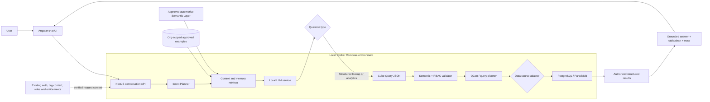

# Automotive Conversational AI PoC — Implementation Plan

**Status:** PoC implementation in progress — local model, governed query path, RBAC proof, and first chat UI implemented
**Reference:** Wren AI  
**Foundation:** [automotive-search](https://github.com/Kaushiik-13/automotive-search)  
**Approval rule:** No application-code changes until you approve the plan and the specific change set for each stage.

## Current decisions — 2026-11-12

- Build the PoC with open-source tools and run the language model locally. No
  cloud LLM or paid model API fallback.
- Keep the existing Angular/NestJS application, automotive PostgreSQL data,
  authentication, organization roles, and row-level security as the foundation.
- Use the project-owned Cube Query JSON contract and QGen. Model output remains
  a proposal that is validated and compiled by backend code; it never supplies
  SQL, organization IDs, or role choices.
- Prefer Ollama as the local model runtime. Choose the exact model only after
  checking machine resources and that model's own license.
- Exclude Excel/DuckDB and RAG/document retrieval from the current PoC. They are
  deferred and require a separate scope decision before any work begins.
- Keep cost, supplier status, weight, and source-tracking fields outside the
  conversational semantic model for the initial PoC.

### Open-source components and license notes

| Area                | PoC choice                        | License / boundary                                                                                                                             |
| ------------------- | --------------------------------- | ---------------------------------------------------------------------------------------------------------------------------------------------- |
| Database            | Existing PostgreSQL with ParadeDB | PostgreSQL uses its permissive PostgreSQL License. ParadeDB Community is AGPL-3.0; keep this visible when distributing or hosting the product. |
| Local model runtime | Ollama, preferred                 | Ollama software is MIT-licensed. Model weights have separate terms and must be reviewed before selection.                                      |
| Semantic query      | Project-owned Cube Query and QGen | Only approved semantic fields are exposed; all filters and limits are parameterized.                                                           |
| Excel analytics     | Deferred                          | DuckDB is a possible later choice; no Excel ingestion or DuckDB service is in this PoC.                                                        |
| Document retrieval  | Deferred                          | No RAG, embeddings, vector index, or document ingestion in this PoC.                                                                           |
| Packaging           | Docker Compose                    | Local services and data stay on the development machine by default.                                                                            |

References: [PostgreSQL license](https://www.postgresql.org/about/licence/),
[ParadeDB license](https://github.com/paradedb/paradedb/blob/main/LICENSE),
[Ollama license](https://github.com/ollama/ollama/blob/master/LICENSE), and
[Ollama local API](https://github.com/ollama/ollama/blob/main/docs/api/openai-compatibility.mdx).

### Current implementation and test status

- The automotive database contains five million generated rows on the D: drive.
- The semantic model, Cube Query v1 schema, validator, and QGen prototype are
  present locally. The Cube Query package has nine passing tests.
- Existing automotive-search validations for Phases 3, 4, 7, 8, and 9 pass.
- Phases 5, 6, and 11 currently fail: Phase 5 has stale expectations for the
  number of development accounts; Phases 6 and 11 find that the seed did not
  populate expected field-access rules. These failures must be resolved before
  pushing. Changes to the separate automotive-search source repo require your
  approval first.
- The authenticated `POST /api/v1/conversation/query` route is integrated with
  the existing session, `catalog.read` permission, protected database context,
  audit event, validator, and QGen. `POST /api/v1/conversation/ask` now accepts
  natural-language questions. Clear common patterns for totals, region
  breakdowns, manufacturer-by-region, sub-commodity, lifecycle status,
  category, and exact part-number questions are mapped to Cube Query JSON
  directly; open-ended questions use local Ollama `qwen3.5:2b`. Every plan
  goes through deterministic validation, QGen, and the protected database
  path. The model does not write or execute SQL.
- A first Angular chat page is available at `/conversation`. It includes
  automotive starter questions, loading/error states, answers and result
  tables, and a compact interpretation trace. The browser keeps the current
  page transcript and sends up to four prior successful questions with their
  interpreted query plans for follow-up understanding. Result rows are not
  included in model context, and every new plan is revalidated and reauthorized.
  Conversation history is not persisted across page sessions.
- The current web and API containers are healthy. Manual browser sign-in and
  chat use remain for the developer to verify. The local development account
  bootstrap service currently exits because its Org A Analyst password no
  longer matches the database after the password was changed; credentials were
  not modified. To keep the running API and web available, they were started
  without rerunning dependent startup jobs. Sync the local development password
  before relying on a fresh full Compose startup.

### Verified RBAC proof for the conversational ask endpoint

The following signed-in account checks returned only the active organization’s
expected row scope. These are proof cases, not a claim that every role and policy
combination has been tested:

| Account context                   | Result from “How many parts are there in total?” |
| --------------------------------- | -----------------------------------------------: |
| Org A administrator (`org-a`)     |                                        5,000,000 |
| Org B administrator (`org-b`)     |                                        1,250,000 |
| Org B restricted viewer (`org-b`) |                                           10,546 |

The same organization-scoped behavior is enforced by the existing authenticated
database path; the model does not choose an organization or role.

### Current local verification

- API lint and build passed; API tests: 13 passed.
- Cube Query package tests: 9 passed.
- Web production build passed; web tests: 8 passed.
- Local-model planner produced a valid supported commodity query; a cost
  question outside the approved semantic model was rejected as unsupported.
- API health and web health endpoints returned healthy after the web image was
  rebuilt. The five-million-row automotive dataset and Ollama model files stay
  on D: (`D:\Docker\WSL-Data` and the ignored project `.data\ollama` folder).
- A proposed golden-question scorecard and organization-product roadmap are in
  [CONVERSATIONAL_AI_EVALUATION.md](CONVERSATIONAL_AI_EVALUATION.md). It records
  known dataset baselines, measurable pass criteria, and the current latency
  variability; it does not approve further code changes.
- The local conversation evaluator now runs 22 golden cases. API lint/build
  pass with 20 API tests; the Cube Query package has 10 passing tests. The
  current total, region, and category fixes passed 9/9 live checks. An
  authorization-context profile and live repeats reduced category query time
  from about 198 seconds to about 31 seconds. The last full evaluation was
  before these fixes (17/22); the whole suite has not been rerun, and Org B
  totals were intentionally not retested. See the evaluation report for the
  measured results and remaining verification.

## Goal and architecture

Build a functional, Wren AI–inspired conversational analytics product for automotive data. A user asks in natural language; the system retrieves relevant business context, plans a governed query, validates it, executes it against an authorized source, and responds with evidence.

```text
Question → Intent Planner → Context Retrieval → Cube Query JSON
         → Semantic + Authorization Validation → QGen / Query Planner
         → Data Source Adapter → Results → Grounded Answer and trace
```

The current PoC is structured PostgreSQL analytics only. The local model proposes
Cube Query JSON; trusted backend code validates it, applies the authenticated
organization context, and executes the bounded query through the protected
database path.

### Proposed architecture diagram



Organization and role authorization is a server-side boundary: the active organization comes from the authenticated session, and validation plus the existing protected database path enforce it before any data is returned. The model never receives database credentials. The diagram shows logical responsibilities; Stage 1 will map them to modules and services already present in the repository before any implementation is proposed.

## Wren AI reference

Wren's published architecture separates agent workflow, project context, planning, and execution. Its current OSS docs describe a versioned semantic contract (MDL), context/memory retrieval, SQL planning, validation, and connectors. These are architectural references; this plan does not assume we will use Wren source code. Wren's docs distinguish its current OSS context engine from the earlier chat-first GenBI Classic product, which is sunset.

- [Wren AI architecture](https://docs.getwren.ai/oss/concepts/architecture/)
- [How Wren AI works](https://docs.getwren.ai/oss/overview/how_wrenai_works)
- [Wren AI Modeling Definition Language](https://docs.getwren.ai/oss/engine/concept/what_is_mdl)
- [Wren AI correctness workflow](https://docs.getwren.ai/oss/concepts/correctness)

## ThoughtSpot Spotter reference

Add **ThoughtSpot Spotter** as a second product reference. Its current product documentation describes governed, use-case-scoped Analysts, model context and business instructions, conversational follow-ups, explanations, feedback/coaching, and interactive visual results. For our PoC, the transferable product ideas are:

- Configure the assistant for an automotive use case with an explicit, approved data context and starter questions.
- Let users refine a result conversationally (for example, change a filter or compare a different period) while revalidating every turn.
- Make answers inspectable: explain the selected business definitions, filters, and result evidence.
- Collect feedback as a review signal; do not silently promote user feedback into trusted semantic definitions.
- Render query results as interactive tables/charts when useful, while keeping the underlying answer grounded in governed query output.

We will not assume ThoughtSpot's internal BARQ/token-search engine or proprietary components. Our equivalent contract remains Semantic Layer → Cube Query → Validator → QGen → source adapter. Spotter's use-case-scoped Analysts map to an optional automotive assistant profile with approved context, permissions, and starter prompts.

- [ThoughtSpot Spotter overview](https://docs.thoughtspot.com/cloud/26.10.0.cl/spotter)
- [Spotter Analysts: governed, use-case-scoped assistants](https://developers.thoughtspot.com/docs/customize-spotter-analysts)
- [Spotter conversation APIs](https://developers.thoughtspot.com/docs/spotter-agent-conversation-apis)

## PoC scope

The current PoC proves one end-to-end scenario in the automotive domain:

1. **PostgreSQL analytics:** answer a supported count/group/filter question using the approved semantic model, Cube Query validation, QGen, and the existing protected PostgreSQL path.

The existing automotive PostgreSQL database is the only data source in this PoC. Excel/DuckDB and RAG are deferred. Exact questions, fields, and measures must be chosen from the actual schema and current row-level security policies.

Use a local LLM only, with no cloud fallback. Ollama is the preferred runtime;
select the exact model after checking machine RAM/VRAM, response-time needs,
structured-output behavior, and the model's license.

Outside the current PoC: chat-driven catalog writes, arbitrary model-written SQL, public deployment, Excel/DuckDB, document ingestion, RAG, and hybrid answers.

## Modules and responsibilities

### User interface

Extend the Angular app with chat turns and follow-ups, automotive result cards/tables, optional charts for supported aggregations, loading/error states, a query trace, and automotive-specific starter questions. Show interpreted measures/dimensions/filters and validation/execution status without exposing sensitive values. Start with session-scoped history unless durable saved history is approved. Feedback is captured for review, not automatically treated as truth.

### Authentication, organization context, and RBAC

Reuse current sign-in, organization selection, roles, entitlements, API guards, field rules, and database row policies. Derive user and active organization from trusted server context, never from prompts, model output, or unchecked request fields. Authorize before exposing semantic metadata, planning, executing, and returning results/history. Reauthorize every follow-up. Scope examples and conversations to the organization. Chat cannot grant privileges beyond existing permissions.

### Data source abstraction and ingestion

Use the existing protected PostgreSQL path as the only source adapter in this
PoC. Preserve PostgreSQL/ParadeDB, database roles, row-level policies, and
parameterized read-only access. Keep a future adapter extension point in the
design, but do not build a source registry, workbook ingestion, DuckDB worker,
or file-handling flow now.

### Semantic Layer (automotive MDL-like project)

Create a small, approved business contract over the automotive PostgreSQL
tables: models/entities, exposed columns, keys, relationships and allowed joins;
descriptions, synonyms, units and enum meanings; approved dimensions and
measures with aggregation behavior; default filters; and role-sensitive fields.

Keep definitions reviewable and versioned. Introspection/model-generated suggestions are drafts until approved. Do not expose every database column by default.

### Context retrieval and memory

For each question, retrieve only relevant semantic models, fields, relationships, metrics, rules, authorized profiling facts, and approved examples. Record context provenance for the trace. Memory is organization-scoped; feedback and previous answers are not trusted definitions until reviewed.

### Intent Planner and Cube Query JSON

Classify as structured lookup/analytics, clarification-needed, or unsupported.
For structured intent, the local model proposes a versioned, constrained Cube
Query JSON object containing approved model, measures, dimensions, filters,
sorting, and limits. Cube Query is an intermediate contract, not SQL.

Illustrative only; final schema depends on the automotive model:

```json
{
  "model": "automotive_catalog",
  "measures": ["part_count"],
  "dimensions": ["category"],
  "filters": [{ "field": "make", "operator": "equals", "value": "Toyota" }],
  "limit": 50
}
```

The current PoC supports `part_count` and a distinct `manufacturer_count`.
For example, counting manufacturers that make brake pads uses the approved
`manufacturer_count` measure and the `brake-pads` category filter. Other
aggregations should be added as explicit semantic measures with tests, rather
than inferred from arbitrary database fields.

Follow-up context is revalidated and reauthorized each turn. Do not trust IDs or filters simply because they appeared earlier.

### Semantic Validator, QGen, and execution

The validator checks contract version, models/fields, types/operators, aggregation rules, join paths, limits/complexity, source enablement, user/org/role access, row scope, and field visibility. Ambiguity requires clarification; unsupported requests fail clearly.

QGen converts only validated Cube Query objects into a bounded logical plan and
parameterized PostgreSQL SQL. The LLM has no database credentials; never
execute raw model-generated SQL. Queries are read-only, bounded, and subject to
timeouts.

The PostgreSQL adapter handles connection lifecycle, type normalization,
limits, and structured results on the existing protected application path.
Keep a reviewable query trace with selected semantic objects, validation,
source, redacted/role-gated plan, status, and timing.

### Deferred: Excel/DuckDB and RAG

Excel/DuckDB ingestion, document ingestion, embeddings, RAG, and hybrid answers
are outside this PoC. Revisit them only after the PostgreSQL conversational
slice is complete and you approve a separate scope and change proposal.

### Results and quality loop

Return concise answers grounded in authorized structured rows, with tables/cards
and optional simple charts. Explain empty results, ambiguity, validation
failures, and model outages. Maintain a small golden set of automotive
questions with expected Cube Query meaning, access outcome, and result shape.
Support dry-plan/validation and bounded clarification; never silently broaden
access or alter a metric.

## Detailed engineering decisions from the learning notes

### Separate proposal, meaning, SQL safety, and execution

The LLM proposes intent and Cube Query JSON; trusted backend components own all consequential decisions. Treat correctness as several separate questions:

| Check                | What it establishes                                                             | Example failure                                           |
| -------------------- | ------------------------------------------------------------------------------- | --------------------------------------------------------- |
| Contract correctness | The JSON has the expected structure and supported operators                     | Unknown property or invalid filter type                   |
| Semantic correctness | The request maps to the intended business definitions, relationships, and grain | “Manufacturer” could mean the part maker or vehicle brand |
| SQL structure/safety | QGen produced only allowed, parameterized, read-only SQL over modeled objects   | A write statement or unapproved function/table            |
| Authorization        | The signed-in actor may read the requested semantic fields and rows             | An organization boundary is crossed                       |
| Result correctness   | The executed query computes the expected metric over the correct scope          | A compatibility join counts the same part several times   |
| Answer faithfulness  | The summary says only what the returned rows and evidence support               | Inferring inventory availability from catalog presence    |

Passing one check does not imply passing the others. SQL parsing/AST inspection is useful but is not a replacement for building queries from approved operations, database privileges, row policies, limits, and result-level evaluation.

### Build in a deterministic-first order

The first engineering proof should not start with prompt tuning. Recommended implementation sequence:

1. Inspect real schema, keys, cardinality, roles, RLS, policies, and existing APIs (read-only).
2. Define the small automotive semantic model and a versioned Cube Query JSON contract.
3. Hand-author a few valid Cube Query examples and expected results.
4. Implement semantic validation, deterministic QGen, parameter binding, and a protected read-only executor.
5. Compare output with independently written reference SQL, including authorization and join-grain cases.
6. Only then ask the local LLM to propose Cube Query JSON; invalid proposals must be clarified or rejected.
7. Add structured conversation state and visual results. Keep Excel/DuckDB and RAG deferred unless you approve a later PoC scope change.

Our Cube Query is our own contract. It is not ThoughtSpot AgentQL, Wren MDL, Wren's cube API, or raw SQL. If Wren is evaluated as an engine, place it behind an adapter and test its actual API/version, query syntax, dialect output, correctness, licensing, runtime footprint, and tenancy compatibility before adoption. Keep a go/no-go record; do not assume Wren's commercial authorization features are present in OSS core.

### Automotive semantic modeling and join grain

Use domain terms with explicit meaning. “Manufacturer” may mean component manufacturer or vehicle brand; ask when context cannot disambiguate. “Available parts” needs an approved definition (for example active status plus organization scope); catalog presence alone does not prove inventory availability.

The Parts → Compatibility → Vehicles relationship is likely one-to-many or many-to-many, but its actual cardinality must be verified. When asking for unique catalog parts by manufacturer or vehicle, define a distinct-part measure at the correct grain. Test multi-compatible parts so a join cannot inflate counts. Do not assume foreign keys alone define approved business join paths.

### Tenant-safe PostgreSQL execution and recovery

Use least-privileged read-only credentials and enforce permissions in the application and database where possible. Test RLS using a runtime role that cannot bypass it. Establish tenant context transaction-locally for each operation; never trust a pooled connection's previous session state. Apply statement timeout, row/result limits, and concurrency limits. Roll back failed transactions before connection reuse, and discard unhealthy connections. Errors/logs must not disclose another tenant's rows or sensitive SQL values.

### Follow-up state is structured

Keep a validated analytical state (last accepted Cube Query, selected metrics/dimensions, filters, sort, source and relevant history), not only the transcript. A follow-up can propose one of four operations:

| Operation | Example                  | State effect                                       |
| --------- | ------------------------ | -------------------------------------------------- |
| Replace   | “What about Honda?”      | Replace vehicle-brand filter, retain other filters |
| Add       | “Only active parts”      | Add an approved active-parts filter                |
| Remove    | “Include every category” | Remove the category filter                         |
| Reset     | “Start a new analysis”   | Clear the current analytical state                 |

Every proposed change is validated and reauthorized. If it could refer to multiple fields or metrics, ask a clarification. Start without long-term AI memory; add tenant-scoped approved examples only when their governance and retention are defined.

### Typed results, visualizations, and provenance

The API should return typed columns/rows, a grounded summary, a validated visualization specification, and provenance such as semantic-model version, metric definition, filters, query identifier, source, and whether displayed rows are truncated. Choose basic KPI/table/bar/line displays deterministically from result shape; fall back to a table when uncertain. Distinguish pagination from an aggregate calculated on incomplete data. Explain NULL, empty results, sampled/truncated outputs, and errors accurately. Never invent causes or trends from descriptive summaries.

### Product validation and differentiation

ThoughtSpot is a product-behavior reference (guided use-case context, editable/inspectable interpretation, follow-ups, visual answers, and human-reviewed feedback). Wren is an open-source architecture/reuse candidate. Neither is evidence that our product has a differentiator yet. Record product claims as documented facts, version-specific observations, or hypotheses; verify bug reports and licenses before using them to make decisions.

Our proposed differentiators to validate with users are reliable multi-turn context, transparent interpretation and provenance, tenant-aware governance, guided semantic setup, and clear data-coverage indicators. Measure answer correctness, join/metric correctness, unauthorized leakage, how often a wrong interpretation is caught before execution, correction time, follow-up state retention, and time to first trustworthy answer.

### Source notes

- [Conversational AI — Learning Notes](https://app.notion.com/p/Conversational-AI-Learning-Notes-405c16ecc9ae817f8cd5e1dd382b70ed?pvs=21)
- [Reference — ThoughtSpot Spotter Product Research](https://app.notion.com/p/Reference-ThoughtSpot-Spotter-Product-Research-405c16ecc9ae812096cfd7f84565d954?pvs=21)
- [Reference — Wren AI Architecture Research](https://app.notion.com/p/Reference-Wren-AI-Architecture-Research-405c16ecc9ae81de95d8c7ee66a07879?pvs=21)

## Proposed project structure

Extend the existing Angular/NestJS/PostgreSQL monorepo. Do not duplicate identity, database, or authorization. Adapt exact paths after read-only inspection.

```text
apps/
  api/src/
    conversation/              # endpoints, turn orchestration, conversation scope
    semantic/                  # automotive model registry and context retrieval
    planner/                    # intent routing and question decomposition
    cube-query/                 # versioned contract and schema validation
    qgen/                       # validated Cube Query -> target plan/SQL
    data-sources/
      postgres/                 # existing protected access path adapter
    llm/                        # local provider interface/implementation
    answers/                    # response formatting and evidence
  web/src/app/features/
    conversation/               # chat, trace, result views and citations
    semantic-admin/             # only if approved; otherwise reviewed model files
semantic/
  automotive/                   # reviewable semantic definitions
  examples/                     # approved question -> Cube Query examples
database/migrations/            # only for specifically approved persistence
compose.yaml                    # existing services plus PoC services
.env.example                    # settings only; no secrets
docs/
  conversational-ai-architecture.md
  conversational-ai-plan.md
  local-development.md
```

Proposed runtime services for this PoC: existing web/API/PostgreSQL and a
local model server. Use persistent volumes for database data and model weights.
Keep model access on the internal Compose network by default. Existing catalog
app should still start if the model is unavailable; chat then reports that
clearly. Document CPU operation; GPU support is optional and host-dependent.

## Approval-gated delivery stages

At every stage I will show files, behavior and material risks for the next change and wait for your explicit approval before editing application code. Approving this plan does not approve later stages.

| Stage                        | Work                                                                                                                                                               | Review point                                                                                      |
| ---------------------------- | ------------------------------------------------------------------------------------------------------------------------------------------------------------------ | ------------------------------------------------------------------------------------------------- |
| 0. Plan                      | Agree scope, architecture, sample questions and local model constraints                                                                                            | You approve/revise this document                                                                  |
| 1. Read-only assessment      | Inspect checkout/current edits, API/auth/RBAC, schema/search, Docker; map existing vs missing modules                                                              | Report findings and exact Stage 2 file list; no edits                                             |
| 2. Semantic foundation       | Small automotive model, Cube Query schema, measures/dimensions, validation, golden examples                                                                        | Show definitions and file list for approval                                                       |
| 3. PostgreSQL vertical slice | Implemented: local LLM → Cube Query → validation → QGen → protected PostgreSQL → grounded answer; recent follow-up context and one validation-repair attempt added | Basic planner and follow-up evaluation passed; persisted conversation history remains future work |
| 4. RBAC proof                | Implemented for Org A admin, Org B admin, and restricted Org B viewer on the ask endpoint                                                                          | Broader role/field/error/history cases remain to be tested                                        |
| 5. Docker integration        | Implemented local Ollama and web/API Compose integration; all runtime files and data are on D:                                                                     | Fresh full startup needs the changed Org A Analyst password synced with the database              |
| 6. Verification/handoff      | Build and unit checks passed; API and web health confirmed                                                                                                         | Developer manual sign-in and chat check remains                                                   |

The existing application may already implement some pieces; Stage 1 establishes this so we do not rebuild them.

Excel/DuckDB and RAG/hybrid work are deferred beyond these stages and are not
part of current PoC acceptance.

## Acceptance criteria

- A signed-in user asks supported automotive questions and receives evidence-backed answers.
- PostgreSQL analytics traverses semantic definitions, Cube Query, validation, QGen and the protected adapter.
- No prompt, payload, conversation ID or model output crosses an organization boundary or adds privileges.
- No arbitrary model SQL executes; queries are validated, parameterized, bounded and read-only.
- Ambiguity, unsupported questions, empty results, and model outages are handled clearly.
- Results expose appropriate provenance; a small golden set documents demonstrated behavior.
- The PoC runs locally through Docker Compose without a cloud LLM dependency.

## Assumptions to review

1. Extend automotive-search and preserve PostgreSQL/ParadeDB, Angular, NestJS, authentication and RBAC.
2. PostgreSQL is the only data source in the current PoC.
3. Excel/DuckDB and RAG/hybrid capabilities are deferred and require a separate approval.
4. Ollama is the preferred local runtime; choose the model after checking machine resources and its license.
5. Begin with reviewed semantic files, not a full semantic-admin UI, unless you request it.
6. Decide conversation persistence, file retention and semantic-definition approvers before implementing those features.
7. Ground exact questions, measures, dimensions and role behavior in the actual schema/policies during Stage 1.
8. Plan approval does not approve code; each stage requires its own concrete proposal and your approval.
