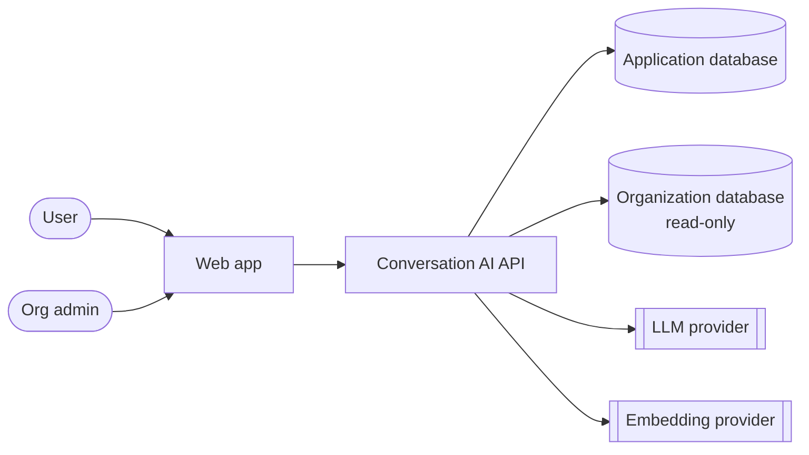
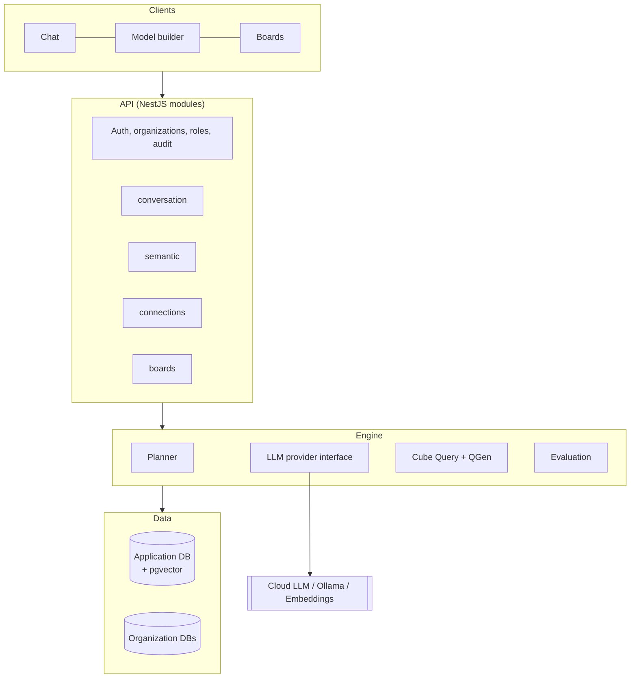
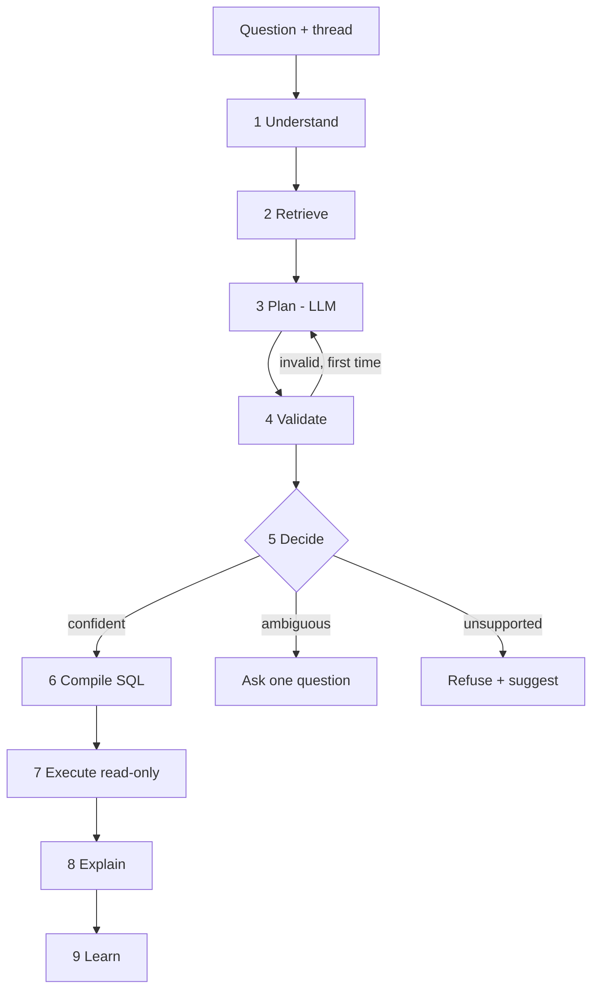

# Conversation AI: Product Architecture

**Scope:** the target design of the product only. What exists today and the
gaps are in [CURRENT_STATE.md](CURRENT_STATE.md); delivery order is in
[ROADMAP.md](ROADMAP.md); why we chose this is in [DECISIONS.md](DECISIONS.md).

## 1. What the product is

Organizations connect their own PostgreSQL database and ask questions in
everyday language. The model proposes a **structured plan**. Trusted code
validates the plan against the user's role and compiles the SQL. Every question
ends in one of three outcomes: a correct answer, one clarifying question, or an
honest refusal with a nearby suggestion.

### Design principles

1. **Any wording.** The model understands meaning; we do not predict phrasings.
2. **Plan-first.** The LLM returns a plan, never SQL, organizations or roles. Free-form SQL is a later optional mode.
3. **Right, ask, or refuse.** Never a silent wrong number.
4. **Explainable.** Show the interpretation, the plan and the SQL.
5. **Tenant isolation is mandatory.** No prompt, plan or thread id can reach another organization's data.
6. **Measured quality.** An evaluation suite gates every model, prompt or semantic change.
7. **Read-only.** The product never changes the organization's data.

## 2. System context



| Actor / system        | Role                                                                                 |
| --------------------- | ------------------------------------------------------------------------------------ |
| User                  | Asks questions, follows up, pins answers                                             |
| Org admin             | Connects the database, reviews and publishes the semantic model, manages roles       |
| Web app               | Chat, model builder, boards (Next.js)                                                |
| Conversation AI API   | NestJS: authentication, authorization, planning, execution, persistence              |
| Application database  | Identity, organizations, roles, semantic models, threads, boards, audit (PostgreSQL) |
| Organization database | The customer's own data. Read-only. One connection per organization                  |
| LLM provider          | Turns a question plus a model slice into a plan. Cloud first, Ollama optional        |
| Embedding provider    | Vectors for field and value retrieval                                                |

## 3. Layers



| Module                                    | Responsibility                                                                                |
| ----------------------------------------- | --------------------------------------------------------------------------------------------- |
| `auth`, `organizations`, `roles`, `audit` | Sessions, active organization, permissions, field access, audit trail                         |
| `conversation`                            | Ask endpoint, threads, messages, streaming responses                                          |
| `semantic`                                | Per-organization models, versions, field index, role access to fields                         |
| `connections`                             | Organization database connections, encrypted read-only credentials, schema scan               |
| `boards`                                  | Pinned answers, saved questions, feedback                                                     |
| `planner`                                 | Understand, retrieve, plan, validate, decide                                                  |
| `llm`                                     | Provider interface (`plan`, `summarise`, `embed`), adapters, timeouts, retries, usage logging |
| `cube-query`                              | Plan contract, validation, parameterised SQL compile. Reads the model it is given             |
| `evaluation`                              | Paraphrase suites per organization, regression gate                                           |

## 4. Question pipeline



| Step         | What happens                                                                                                                                                           | Example                                                                             |
| ------------ | ---------------------------------------------------------------------------------------------------------------------------------------------------------------------- | ----------------------------------------------------------------------------------- |
| 1 Understand | Resolve the organization's published model; rewrite a follow-up into a standalone question                                                                             | "now only North" becomes "revenue by region, electronics, last quarter, North only" |
| 2 Retrieve   | Embeddings pick the few relevant fields and synonyms; value matching maps typed words to real values. The model sees only this slice, and only fields the role may see | "electronics" becomes `category = Consumer Electronics`                             |
| 3 Plan       | LLM returns a plan that must match the plan schema                                                                                                                     | `measure: revenue, group_by: region, filters: …, sort: revenue desc, limit: 5`      |
| 4 Validate   | Fields exist, role may use them, limits respected, no other organization reachable. Invalid plan returns to the model once with the error                              | A plan naming `cost` for a Viewer is rejected                                       |
| 5 Decide     | Exactly one of: answer, one clarifying question, refusal with a suggestion                                                                                             | "Revenue or units sold?"                                                            |
| 6 Compile    | QGen produces parameterised SQL from the validated plan only                                                                                                           | Values are bound parameters                                                         |
| 7 Execute    | Read-only transaction on the organization's connection with statement timeout and row cap                                                                              |                                                                                     |
| 8 Explain    | Table, auto-chart, short summary, "I understood …" line with one-click correction, plan and SQL panel                                                                  | "North leads at $1.2M, 18% above South"                                             |
| 9 Learn      | Log question, retrieved fields, plan, outcome, latency, rating. Feedback feeds the evaluation set, never trusted policy without review                                 |                                                                                     |

## 5. Plan contract

The plan is the product's central data structure. It is declarative and
validated; it cannot express anything outside the semantic model.

| Element                  | Meaning                                                                |
| ------------------------ | ---------------------------------------------------------------------- |
| `measures`, `dimensions` | What to compute and group by, by semantic field key                    |
| `filters`                | Field, operator, value, including date ranges and relative periods     |
| `time_grain`             | Day, week, month, quarter, year for trends                             |
| `compare`                | Previous period or previous year                                       |
| `share_of_total`         | Percent of the whole                                                   |
| `derived`                | Ratio of two measures                                                  |
| `running`                | Cumulative total over an ordered field                                 |
| `top_n_per_group`        | Rank within each group                                                 |
| `having`                 | Filter on an aggregate                                                 |
| `source`                 | A nested plan whose result feeds the outer plan (multi-step questions) |
| `order_by`, `limit`      | Sorting and row cap, bounded by model limits                           |

Coverage targets:

| Question type            | Example                          |
| ------------------------ | -------------------------------- |
| Totals, counts, averages | "Average order value"            |
| Group, rank, limit       | "Top 5 regions by revenue"       |
| Relative time            | "Last quarter", "since March"    |
| Trends                   | "Revenue by month this year"     |
| Period comparison        | "Revenue vs last year"           |
| Share of total           | "What % comes from electronics?" |
| Ratios                   | "Return rate per supplier"       |
| Running totals           | "Cumulative sales this year"     |
| Top N per group          | "Best product in each region"    |
| Multi-step               | "Regions beating the average"    |

Anything the plan cannot express is refused with a suggestion. An optional
free-SQL mode (read-only, role-checked, admin-enabled) is a later extension, not
part of this architecture.

## 6. Semantic model

The semantic model is data, owned per organization, versioned, and editable by
an admin. It is the only description of the organization's data the model ever
sees.

| Piece         | Meaning                            | Example (Acme Retail)                  |
| ------------- | ---------------------------------- | -------------------------------------- |
| Measure       | A number with an agreed definition | `revenue = sum(orders.amount)`         |
| Dimension     | Something to group or filter by    | `region = customers.region`            |
| Relationship  | The only allowed join path         | `orders.customer_id → customers.id`    |
| Time field    | The date used for time questions   | `order_date`                           |
| Synonyms      | Words people actually use          | region: area, territory, zone          |
| Sample values | Real values for matching           | category: Consumer Electronics         |
| Role access   | Who may use which field            | Analyst sees `margin`, Viewer does not |
| Limits        | Max rows, dimensions, filters      |                                        |

Storage (final design settled in Phase 1):

| Table                           | Holds                                                                    |
| ------------------------------- | ------------------------------------------------------------------------ |
| `semantic.models`               | Organization, name, connection, published version                        |
| `semantic.model_versions`       | Immutable JSON document, status (draft or published), author, timestamps |
| `semantic.field_index`          | Per field: label, description, synonyms, sample values, embedding        |
| `semantic.field_access`         | Version, field, role, allowed                                            |
| `org.connections`               | Host, database, user, encrypted secret, last scan                        |
| `chat.threads`, `chat.messages` | Questions, plans, outcomes, ratings, latency, model used                 |
| `boards.*`                      | Pinned answers, saved questions                                          |

One published version is live per model. Drafts are edited in the UI and
published atomically. Old versions are kept so any past answer can be explained.

## 7. LLM provider interface

| Operation                         | Purpose                                                |
| --------------------------------- | ------------------------------------------------------ |
| `plan(question, slice, schema)`   | Returns a plan that must satisfy the plan schema       |
| `summarise(question, plan, rows)` | Short plain-English answer from the computed rows only |
| `embed(texts)`                    | Vectors for field and value retrieval                  |

Requirements: adapters for Gemini and Ollama, per-call timeouts and one bounded
retry, structured-output mode where the provider supports it, usage and latency
logging per organization, and a configuration switch per organization (for
example, on-premises organizations use Ollama). Free provider tiers are for
development only; customer data uses a paid provider with no-training terms or
Ollama.

## 8. Security and tenancy

Safety does not depend on the model behaving. Each gate is ordinary code.

| Gate            | Control                                                                                        |
| --------------- | ---------------------------------------------------------------------------------------------- |
| G1 Session      | Authenticated user; active organization is chosen by the server, never by the question         |
| G2 Prompt slice | Only fields the role may see are retrieved, so the model cannot name a hidden field            |
| G3 Plan schema  | Anything that is not a valid plan is rejected                                                  |
| G4 Validator    | Field existence, role permission, limits, derived-measure rules                                |
| G5 Compiler     | Parameterised SQL generated from the validated plan only                                       |
| G6 Connection   | Read-only credentials, read-only transaction, statement timeout, row cap                       |
| G7 Row rules    | Row-level security in the application database; per-model row rules for organization databases |
| G8 Audit        | Every query records user, organization, fields used, row count                                 |

Organization database credentials are stored encrypted, never returned by any
API, and used only by the `connections` module.

## 9. Quality system

- **Evaluation:** per organization, about 50 questions each in about 10 phrasings, covering every plan type and the security cases (cross-role, cross-tenant, hidden fields).
- **Gate:** a change to prompts, model, provider or semantic version cannot ship if the score drops.
- **Observability:** every interaction logged with retrieved fields, plan, outcome, latency and rating.
- **Feedback loop:** thumbs and corrections are reviewed before they enter the evaluation set or the semantic model.
- **Refusal quality:** unsupported and ambiguous cases have tests too, because an honest refusal is part of correct behaviour.

## 10. Repository layout (target)

```
apps/
  api/src/
    auth/ authorization/ organizations/ roles/ audit/   identity and access
    conversation/        HTTP, threads, streaming
    planner/             understand, retrieve, plan, validate, decide
    llm/                 provider interface and adapters
    semantic/            models, versions, field index, field access
    connections/         organization databases
    boards/              pinned answers, saved questions
  web-next/              Next.js app: chat, model builder, boards
packages/cube-query/     plan contract, validation, SQL compile
database/migrations/     numbered SQL migrations
semantic/automotive/     seed model for the demo organization
evaluation/              golden and paraphrase suites
docs/product/            vision, architecture, roadmap, decisions, current state
```
