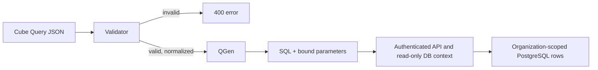

# Study Guide: Our Cube Query Validator and QGen

This guide explains the code in the automotive conversational analytics PoC.
It is a project-specific query format and compiler. It is not the Cube.js
product or a third-party Cube query engine.

## 1. The short version

- **Cube Query** is our small JSON language for describing an approved
  automotive data question.
- **The validator** checks whether the JSON is well-formed, supported, and
  bounded.
- **QGen** turns an accepted request into parameterized PostgreSQL `SELECT`
  SQL using a fixed map of approved database fields.
- **The existing API and PostgreSQL security** check the signed-in user and
  organization before rows are returned.
- **There is no LLM in this flow yet.** The test request supplied Cube Query
  JSON directly. A later planner will turn ordinary language into this JSON.



## 2. Where the implementation lives

Read these files in this order:

1. [`cube-query.v1.schema.json`](../../packages/cube-query/cube-query.v1.schema.json) — the documented JSON shape.
2. [`index.mjs`](../../packages/cube-query/src/index.mjs) — runtime validation and normalization.
3. [`qgen.mjs`](../../packages/cube-query/src/qgen.mjs) — SQL generation and authorized execution helper.
4. [`cube-query.test.mjs`](../../packages/cube-query/test/cube-query.test.mjs) — examples of accepted and rejected requests.
5. [`conversation.controller.ts`](../../apps/api/src/conversation/conversation.controller.ts) and [`conversation.service.ts`](../../apps/api/src/conversation/conversation.service.ts) — the authenticated API route that uses the package.
6. [`database.service.ts`](../../apps/api/src/database/database.service.ts) — the existing database transaction and authorization-context boundary.

The JSON Schema describes the contract, but the API currently runs the
handwritten `validateCubeQuery` function. Keep both aligned when the contract
changes.

## 3. The request format

Example: count visible parts by commodity and return at most ten groups.

```json
{
  "version": 1,
  "model": "automotive_catalog",
  "measures": ["part_count"],
  "dimensions": ["commodity"],
  "filters": [],
  "limit": 10
}
```

The names have specific roles:

- **Model:** which approved business model to query. Only
  `automotive_catalog` is allowed.
- **Measure:** the calculation. The first version supports one measure,
  `part_count`, which counts distinct catalog parts.
- **Dimension:** how to split the measure, such as `commodity`, `region`, or
  `model_year`.
- **Filter:** which values to keep.
- **Order:** optional sorting, using only selected dimensions or measures.
- **Limit:** maximum returned rows/groups. It defaults to 50 and cannot exceed 500.

The JSON cannot name a database organization, role, table, arbitrary SQL, or
database connection. Those choices belong to trusted application code.

## 4. What validation checks

`validateCubeQuery(input)` in `index.mjs` treats incoming JSON as untrusted. It
checks:

- The top-level object has only known properties and uses version 1.
- The model and measure are supported.
- There are at most 3 unique dimensions, 10 filters, and 3 sort entries.
- Every filter field and operator are allowed for that field's type.
- Values have the expected type. For example, `active` needs a Boolean and
  `model_year` needs an integer.
- `in` filters contain 1–50 values; strings are non-empty and at most 256
  characters.
- Sort fields are selected in the query and direction is `asc` or `desc`.
- The limit is an integer from 1 to 500.

Operators by field type:

| Field kind   | Allowed operators                             |
| ------------ | --------------------------------------------- |
| Text fields  | `equals`, `in`, `contains`                    |
| `model_year` | `equals`, `in`, `gt`, `gte`, `lt`, `lte`      |
| `active`     | `equals`, `in`                                |
| `category`   | `equals`, `in` using lowercase taxonomy slugs |

`part_number` and `part_name` are lookup filters only. They cannot be selected
as groupings. Sensitive fields such as cost and supplier status are not in the
allowlist.

On success, validation returns a normalized copy. For example, it fills in
the default limit when omitted. On failure, it returns structured errors with
paths such as `$.filters[0].value` so callers can identify the problem.

Validation answers “is this query allowed by our contract?” It does not prove
that the user is authorized to see the requested rows.

## 5. How QGen creates SQL

`compileCubeQuery(input)` first calls the validator. If validation fails, it
throws `CubeQueryValidationError` and never makes SQL from the invalid input.

For a valid request, QGen uses fixed expression maps, for example:

- `commodity` → `part.commodity`
- `manufacturer` → `part.manufacturer`
- `part_count` → `COUNT(DISTINCT part.id)`

The user/model can select a key from these maps, but cannot provide a SQL
expression. QGen then assembles the `SELECT`, optional joins, filters,
grouping, sorting, and limit.

For the example request, the generated SQL is equivalent to:

```sql
SELECT COUNT(DISTINCT part.id)::text AS part_count,
       part.commodity AS commodity
FROM catalog.part_catalog AS part
GROUP BY part.commodity
LIMIT $1
```

The parameter values are `[10]`. The limit is bound as a value, not inserted
into SQL text.

Filter values are also bound. For a category filter, QGen makes a hierarchy
check using the category slug and path. For a text `contains` filter, it
escapes SQL wildcard characters and uses a bound `ILIKE` pattern. This keeps
user text from becoming SQL syntax.

Category assignments are many-to-many. QGen uses `COUNT(DISTINCT part.id)` so
that a part assigned to multiple categories is not counted multiple times.
When grouping by category, it joins the category tables; category labels with
the same name may currently appear as one group, which is a known modeling
limitation to revisit.

## 6. How authorization is applied

The API route is `POST /api/v1/conversation/query`.

1. `AccessSessionGuard` authenticates the session cookie.
2. `PermissionGuard` requires `catalog.read` for the route.
3. The controller passes the authenticated server session and request body to
   `ConversationService`.
4. QGen validates and compiles the JSON. It does not receive an organization
   or role from the request.
5. The service calls `DatabaseService.withAuthorizationContext(session, ...)`.
   That opens a read-only transaction and asks PostgreSQL to bind the session
   and user as the authorization context.
6. Inside that transaction, QGen checks `catalog.read` again, then executes the
   SQL. PostgreSQL row-level security applies the active organization, role,
   entitlements, and row restrictions.
7. The service records an audit event and returns the normalized query and
   rows.

This is why adding `organizationId` to Cube Query is rejected: organization
scope comes from the authenticated session and database policy, not from user
input. The LLM will eventually propose only the JSON query; it will not receive
database credentials or execute SQL.

## 7. What happened in the manual test

The test logged in as the Org A Analyst and sent the JSON query above to the
API. PostgreSQL returned ten grouped rows, and the response reported
`meta.rowCount: 10`. The test did not send a natural-language prompt, so it
verified the validator → QGen → authorization → PostgreSQL path, not LLM
interpretation.

The package's nine automated tests cover supported and rejected contracts,
limits and types, parameterized SQL, escaped text matching, category hierarchy
and distinct counting, and execution inside the supplied authorization
context.

## 8. Current boundaries and next learning steps

Currently implemented: one measure, a limited field allowlist, one automotive
model, a read-only PostgreSQL route, and existing organization-aware database
security. Excel/DuckDB and RAG remain excluded.

Not implemented yet: natural-language planning, local LLM connection, chat UI,
multi-turn follow-up state, visualization selection, and user-facing
explanations. Those pieces will come later and must produce or consume the same
validated query contract.

To study the logic hands-on, change one request at a time in the test file:

1. Change `dimensions` and predict the SQL `GROUP BY`.
2. Add a typed filter and predict the parameter list.
3. Try an unsupported field such as `cost_usd` and trace the validation error.
4. Add a category filter and trace its hierarchy SQL.
5. Follow the authorized execution helper into the database service and find
   where the session context is bound.

Run the package checks from its directory with `npm test`.
